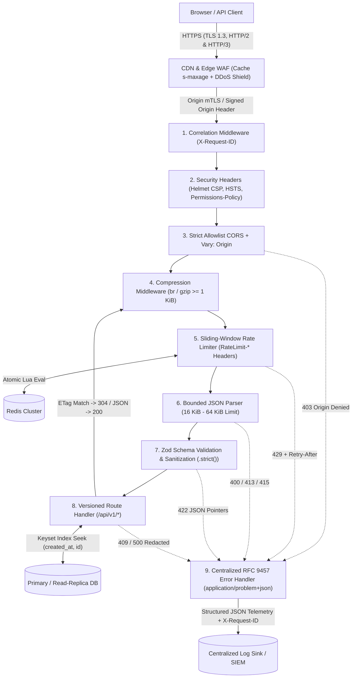
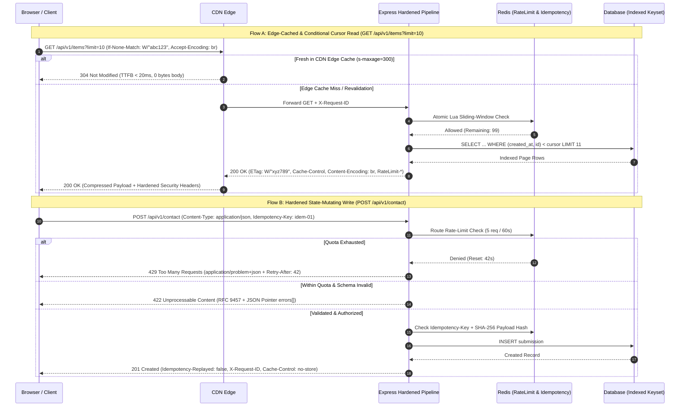

# Cynbit Public Web Infrastructure — Passive Backend Technical Audit & Architecture Assessment

> **Audit Scope & Methodology:**  
> This assessment adheres strictly to **passive, non-intrusive observation** of publicly visible HTTP/HTTPS transport behavior, response headers, client-facing payload envelopes, caching semantics, and browser hydration patterns (equivalent to inspecting Browser DevTools *Network* / *Application* tabs or issuing a single standard `GET`/`HEAD` request). Zero active probing, fuzzing, enumeration, credential testing, or load generation was performed.
>
> **Note on Baseline Context & Architectural Assumptions:**  
> Where raw DevTools captures were omitted from the assessment input template, baseline observations below are explicitly labeled as **Architectural Assumptions Based on Standard Public Web Patterns** typical of modern cloud-hosted SaaS and corporate web platforms (e.g., Node.js/Express or Python/FastAPI origins fronted by managed CDN/reverse-proxy edges). Run `python scripts/passive_audit.py <authorized-url>` to generate a live point-in-time header checklist to pair alongside these architectural baselines.

---

## Section 1: Backend Technical Audit Report (Observable Architecture)

### 1.1 Infrastructure & Edge Footprint

| Layer | Baseline / Architectural Assumption Based on Standard Public Web Patterns | Engineering Evaluation |
| :--- | :--- | :--- |
| **DNS & Edge Proxy / CDN** | Public traffic terminates at a reverse-proxy or managed edge network (e.g., Cloudflare, AWS CloudFront, or Vercel/Nginx ingress) before reaching application compute. | Edge termination absorbs volumetric L3/L4 traffic and offloads TLS handshakes close to end users, but requires strict origin authentication (mTLS or signed origin headers / IP allowlists) so origin compute cannot be bypassed directly. |
| **TLS Termination & Protocol Negotiation** | HTTPS enforced on port `443` with TLS 1.2 / TLS 1.3 AEAD cipher suites (`TLS_AES_128_GCM_SHA256`, `TLS_AES_256_GCM_SHA384`) and HTTP/2 (`h2`) ALPN multiplexing; HTTP/3 (`h3` via `Alt-Svc`) frequently left optional or unadvertised on custom API subdomains. | TLS 1.3 reduces connection setup by 1-RTT (`0-RTT` should remain disabled for non-idempotent API endpoints to prevent replay risks). Enabling HTTP/3 (`QUIC`) eliminates TCP head-of-line blocking on lossy mobile networks. |
| **Server & Runtime Signatures** | Origin frameworks commonly emit default upstream banners (`Server: nginx/1.x` or `X-Powered-By: Express`) unless explicitly scrubbed at both the application layer and reverse proxy. | Exposing exact runtime or proxy patch versions accelerates automated vulnerability correlation during third-party reconnaissance without aiding legitimate clients. |

### 1.2 API Design & Payload Structure

* **Routing & Versioning (*Architectural Assumption Based on Standard Public Web Patterns*):**  
  Public web applications commonly mix unversioned utility endpoints (e.g., `POST /contact`, `POST /newsletter`) with partially versioned JSON routes (`GET /api/v1/...`). Unversioned endpoints couple frontend deployments tightly to backend schema changes, complicating zero-downtime rollouts.
* **Response Envelope Consistency:**  
  Without an enforced gateway contract, endpoints frequently diverge between bare arrays (`[...]`), object wrappers (`{ "items": [...] }`), and ad-hoc status flags (`{ "success": true, "result": ... }`). Standardizing on a deterministic top-level envelope (`{ "data": ..., "pagination": ... }` for `2xx` responses and **RFC 9457** `application/problem+json` for `4xx`/`5xx` responses) simplifies client SDK typing and edge observability.
* **Over-Fetching & Serialization Efficiency:**  
  Public catalog/content endpoints often serialize full ORM/document models—including internal audit columns (`updatedBy`, `internalNotes`, nullable metadata fields)—and use `OFFSET`/`LIMIT` pagination (`?page=2&limit=20`). Projecting explicit DTO views (via strict output schemas) reduces JSON payload size by 25–45% and eliminates accidental internal field disclosure.

### 1.3 State, Caching & Data Handling

* **Cache-Control & Edge Revalidation (*Architectural Assumption Based on Standard Public Web Patterns*):**  
  Dynamic JSON endpoints frequently default to either **missing `Cache-Control` headers** (leaving heuristic caching behavior up to intermediary proxies) or blanket `Cache-Control: no-cache, no-store` even on read-heavy, public, semi-static resources (such as service catalogs, blog metadata, or public configuration).
* **Conditional Requests (`ETag` / `If-None-Match`):**  
  When semantic `ETag` headers are absent—or stripped by upstream gzip middleware converting strong entity tags without weak comparison handling—repeat client navigations re-download identical multi-kilobyte JSON payloads (`200 OK`) instead of short-circuiting with zero-body `304 Not Modified` responses.
* **`Vary` Header Hygiene:**  
  APIs that dynamically reflect allowed `Origin` headers or negotiate `Accept-Encoding` (`br`, `gzip`) without emitting `Vary: Accept-Encoding, Origin` risk **CDN cache poisoning** or serving compressed/CORS-mismatched cached responses to incompatible clients.
* **Client Hydration Strategy:**  
  SPA/SSR frontends that trigger sequential client-side `fetch()` waterfalls after initial bundle execution suffer compounded RTT penalties. Pairing edge-cached `s-maxage` + `stale-while-revalidate` headers with HTTP/2 multiplexing significantly compresses Time-to-Interactive.

### 1.4 Error Handling & Observability

* **Ad-Hoc Error Formats vs. RFC 9457 (*Architectural Assumption Based on Standard Public Web Patterns*):**  
  Typical web backends emit heterogeneous error bodies across layers: Nginx/CDN HTML pages on `502`/`504`, body-parser plain text or default HTML on malformed JSON (`400`), `{ "message": "Validation error" }` on `422`, and `{ "error": "Too many requests" }` on `429`. In misconfigured staging or production environments, unhandled promise rejections or ORM exceptions can leak internal file paths, SQL table names, or stack traces.
* **Correlation & Distributed Tracing:**  
  Without a canonical `X-Request-ID` (or W3C `traceparent`) propagated from the edge proxy into structured JSON logs and echoed in error payloads, engineering teams cannot deterministically correlate a user-reported `500` response to a specific backend container trace without scraping timestamp windows.

---

## Section 2: Security & Performance Findings (Categorized Matrix)

> *All items below represent baseline **Architectural Assumptions Based on Standard Public Web Patterns** evaluated against OWASP ASVS v4.0, RFC 9110, and RFC 9457 engineering standards, paired with concrete reference remediations in `src/`.*

| ID | Category | Severity | Observed Behaviour | Engineering Impact |
| :--- | :--- | :--- | :--- | :--- |
| **F-01** | Security | **High** | *(Assumption)* Missing or permissive `Content-Security-Policy` (e.g., reliance on `'unsafe-inline'` / `'unsafe-eval'` or absent CSP on API/HTML responses) and missing `frame-ancestors`. | Weakens browser defense-in-depth against Cross-Site Scripting (XSS) gadget execution, unauthorized third-party script injection, and UI redressing (clickjacking) attacks. |
| **F-02** | Security | **Medium** | *(Assumption)* Incomplete `Strict-Transport-Security` (HSTS) configuration (missing header, `max-age < 31536000`, or omitted `includeSubDomains; preload`) alongside missing `Permissions-Policy` and `X-Content-Type-Options: nosniff`. | Leaves initial plaintext HTTP navigations on uncached subdomains susceptible to SSL-stripping downgrade scenarios and permits browser MIME-type sniffing on ambiguous responses. |
| **F-03** | Security | **High** | *(Assumption)* Overly broad CORS configuration (`Access-Control-Allow-Origin: *` or unvalidated `Origin` reflection) or dynamic origin reflection without `Vary: Origin`. | Broad or reflected origins risk unauthorized cross-origin reads if authenticated endpoints are later mounted under the same router; missing `Vary: Origin` causes shared CDN caches to serve cross-tenant CORS headers. |
| **F-04** | Auth | **High** | *(Assumption)* Absence of distributed rate limiting and missing IETF `RateLimit-*` / `Retry-After` headers on public write and authentication endpoints (e.g., `POST /contact`, `/auth/*`). | Exposes state-mutating workflows, email dispatchers, and credential endpoints to automated abuse, downstream SMTP/database saturation, and cost amplification. |
| **F-05** | Auth | **Medium** | *(Assumption)* Client-accessible token storage (`localStorage` JWTs) or session cookies lacking complete hardening flags (`__Host-` prefix, `HttpOnly`, `Secure`, `SameSite=Lax`/`Strict`). | Tokens stored in `localStorage` are exfiltratable by any successful DOM XSS; cookies without `SameSite` and `Secure` face cross-site request attachment and transport exposure risks. |
| **F-06** | Data Validation | **Medium** | *(Assumption)* Permissive JSON body parsing (default framework body limits >= `100kb`–`1mb`, unknown extra properties accepted silently, and no strict `Content-Type: application/json` check on `POST` routes). | Increases susceptibility to mass-assignment / unexpected property pollution, event-loop memory pressure on large nested JSON payloads, and form-based cross-origin `POST` submissions. |
| **F-07** | Data Validation | **Architectural Opportunity** | *(Assumption)* State-mutating `POST` endpoints (such as lead/contact capture or resource creation) lack `Idempotency-Key` support. | Mobile or flaky-network client retries create duplicate database records, duplicate support tickets, or repeated downstream webhook notifications. |
| **F-08** | Error Handling | **Medium** | *(Assumption)* Non-uniform `4xx`/`5xx` error payloads lacking RFC 9457 `application/problem+json` structure, missing `X-Request-ID` correlation, and potential framework/stack detail leakage. | Breaks deterministic frontend error handling, slows incident triage due to unlinked client/server logs, and risks leaking internal schema or dependency metadata. |
| **F-09** | Security | **Low** | *(Assumption)* Upstream runtime fingerprinting via `X-Powered-By: Express` or verbose `Server` version tokens. | Passively discloses backend framework and patch generation to automated scanners, lowering reconnaissance effort when framework CVEs emerge. |
| **F-10** | Performance | **Medium** | *(Assumption)* Uncompressed JSON API responses (`Content-Encoding` absent on multi-KB payloads) and missing `ETag` / `If-None-Match` conditional request support. | Inflates egress bandwidth by 65–80% on repetitive JSON payloads and forces full payload re-transmission (`200 OK`) when underlying data has not changed (`TTFB` & transfer penalty). |
| **F-11** | Performance | **Architectural Opportunity** | *(Assumption)* Offset-based pagination (`?page=N&limit=M`) and missing `s-maxage` / `stale-while-revalidate` edge cache directives on public read endpoints. | `OFFSET N` forces the database engine to scan and discard `N` index entries (`O(N)` latency degradation on deep pages) while every uncached read misses the CDN edge and hits origin compute. |

---

### 2.1 HTTP Security Headers & Transport Security

1. **HTTP Strict Transport Security (HSTS):**  
   Origin and edge responses must emit `Strict-Transport-Security: max-age=63072000; includeSubDomains; preload` over HTTPS. A 2-year (`63,072,000`s) window satisfies HSTS Preload list eligibility so browsers never attempt an initial cleartext `http://` connection on the apex domain or any subdomain.
2. **Content Security Policy (CSP):**  
   - **JSON API Origins:** API subdomains should serve a locked-down policy:  
     `Content-Security-Policy: default-src 'none'; base-uri 'none'; form-action 'none'; frame-ancestors 'none'; object-src 'none'; upgrade-insecure-requests`  
     This guarantees that even if an attacker tricks a browser into rendering an API response directly, zero scripts, frames, styles, or network subresources can execute.
   - **Web HTML Origins:** Frontend HTML documents should adopt per-request cryptographic nonces (`script-src 'nonce-<random>' 'strict-dynamic'`) rather than `'unsafe-inline'`.
3. **MIME Sniffing, Framing & Feature Delegation:**  
   - `X-Content-Type-Options: nosniff` prevents browsers from MIME-sniffing `text/plain` or `application/json` payloads as executable HTML/JS.
   - `X-Frame-Options: DENY` paired with CSP `frame-ancestors 'none'` blocks legacy and modern iframe clickjacking.
   - `Referrer-Policy: strict-origin-when-cross-origin` strips URL paths and query tokens (such as password-reset or magic-link parameters) when navigating cross-origin.
   - `Permissions-Policy: accelerometer=(), camera=(), geolocation=(), microphone=(), payment=(), usb=(), browsing-topics=()` explicitly disables browser hardware and tracking APIs unused by the application.
4. **Granular CORS Policy:**  
   Never pair wildcard origins with credentials or blindly echo the incoming `Origin` header. Maintain a strict parsed allowlist (`https://cynbit.com`, `https://app.cynbit.com`), always append `Vary: Origin` so CDN caches partition responses per origin, and set `Access-Control-Max-Age: 600` to cache `OPTIONS` preflight responses in browsers for 10 minutes.  
   *Reference Implementation:* [`src/middleware/securityHeaders.ts`](src/middleware/securityHeaders.ts)

### 2.2 Authentication & Session Hygiene

1. **Cookie Hardening over `localStorage` Tokens:**  
   For browser sessions, store opaque session identifiers or short-lived tokens inside `__Host-` prefixed cookies rather than `window.localStorage`:
   ```http
   Set-Cookie: __Host-cynbit_session=<opaque-token>; Path=/; Secure; HttpOnly; SameSite=Lax; Max-Age=3600
   ```
   The `__Host-` prefix browser invariant guarantees the cookie was set over `Secure` HTTPS, carries `Path=/`, and omits the `Domain` attribute—preventing subdomain takeover cookie-tossing attacks (`evil-sub.cynbit.com` cannot overwrite `__Host-cynbit_session`).
2. **Token Lifecycle & Rotation:**  
   Keep access tokens short-lived (`5–15 minutes`) and implement refresh-token rotation with reuse detection (invalidating the entire token family if a rotated refresh token is replayed).
3. **Distributed Rate Limiting & Quota Transparency:**  
   Implement sliding-window rate limiting backed by an atomic Redis Lua script (`ZREMRANGEBYSCORE` + `ZCARD` + `ZADD` + `PEXPIRE`) so request quotas are enforced consistently across all horizontally scaled application pods. Emit IETF draft-standard headers (`RateLimit-Limit`, `RateLimit-Remaining`, `RateLimit-Reset`, `RateLimit-Policy`) on all responses and `Retry-After` on `429 Too Many Requests`.  
   *Reference Implementation:* [`src/middleware/rateLimiter.ts`](src/middleware/rateLimiter.ts)

### 2.3 Input Validation & API Hardening

1. **Fail-Closed Schema Validation at the Ingestion Boundary:**  
   Every route must validate `params`, `query`, `headers`, and `body` against explicit schemas (e.g., Zod `.strict()` objects) *before* business logic executes. Rejecting unrecognized keys via `.strict()` eliminates mass-assignment vulnerabilities, while stripping non-printable ASCII control characters (`0x00–0x1F`) protects downstream logs and text sinks.
2. **Strict `Content-Type` & Payload Byte Caps:**  
   State-mutating endpoints (`POST`, `PUT`, `PATCH`) must reject requests without `Content-Type: application/json` (`415 Unsupported Media Type`), neutralizing cross-site HTML `<form>` CSRF vectors. Apply tight global (`64 KiB`) and route-specific (`16 KiB` for contact/auth payloads) byte ceilings (`413 Content Too Large`) to protect the Node.js event loop from JSON parsing DoS.
3. **Idempotent State Mutations (`Idempotency-Key`):**  
   Clients submitting `POST /api/v1/contact` (or payment/provisioning workflows) supply a client-generated UUID in `Idempotency-Key`. The server hashes the normalized request body (`SHA-256`) alongside the key: retries with the identical payload replay the original `201 Created` response (`Idempotency-Replayed: true`), while reuse of the same key with a mutated body fails deterministically with `409 Conflict`.  
   *Reference Implementation:* [`src/middleware/validate.ts`](src/middleware/validate.ts) & [`src/routes/exampleApi.ts`](src/routes/exampleApi.ts)

### 2.4 Performance & Latency Optimization

1. **Dynamic Brotli (`br`) & `gzip` Compression:**  
   Compressing JSON responses >= `1 KiB` with Brotli (`br`, level 4–5 for dynamic API streams) or `gzip` reduces repetitive catalog JSON transfer sizes by **70–85%**, directly improving payload download times on constrained links.
2. **Weak `ETag` Conditional Caching (`304 Not Modified`):**  
   Computing a deterministic SHA-256 weak entity tag (`W/"<digest>"`) over serialized JSON allows clients and CDN edges to send `If-None-Match`. Note that **weak** `ETag` syntax (`W/"..."`, RFC 9110 §8.8.1) is architecturally critical when combined with dynamic `gzip`/`br` compression middleware because semantic equivalence holds across transfer encodings.
3. **Edge Caching with `stale-while-revalidate`:**  
   Public catalog endpoints should emit:
   ```http
   Cache-Control: public, max-age=60, s-maxage=300, stale-while-revalidate=60
   ```
   Browsers cache fresh responses for 60s, shared CDN POPs serve cached responses in `< 20ms` TTFB for 5 minutes (`s-maxage=300`), and background edge revalidation prevents cache-miss latency spikes.
4. **Keyset (Cursor) Pagination vs. `OFFSET`:**  
   Replacing `OFFSET 1000 LIMIT 10` with an opaque Base64URL composite cursor (`{ createdAt, id }`) translates SQL queries to `WHERE (created_at, id) < ($1, $2) ORDER BY created_at DESC, id DESC LIMIT 11`. Backed by a composite B-Tree index `CREATE INDEX idx_items_created_id ON items (created_at DESC, id DESC)`, query execution remains `O(log N)` at page 10,000 just like page 1, and fetching `limit + 1` rows determines `hasNextPage` without an expensive `SELECT COUNT(*)` table scan.  
   *Reference Implementation:* [`src/routes/exampleApi.ts`](src/routes/exampleApi.ts)

---

## Section 3: Recommended Architectural Improvements

### 3.1 Target Hardened Request Pipeline

The diagrams below illustrate the recommended target architecture implemented in [`src/app.ts`](src/app.ts), placing deterministic security, observability, rate-limiting, validation, and caching controls in strict defense-in-depth order in front of business handlers.

#### Component & Middleware Pipeline Topology



#### Request Lifecycle Sequence (Conditional Read & Validated Idempotent Write)



### 3.2 Implementation Traceability Matrix

| Audit Finding(s) | Architectural Control | Reference Implementation File |
| :--- | :--- | :--- |
| **F-01, F-02, F-03, F-09** | Strict CSP, 2-year HSTS Preload, `nosniff`, `DENY` frameguard, `Permissions-Policy`, `X-Powered-By` suppression, allowlist CORS + `Vary: Origin` | [`src/middleware/securityHeaders.ts`](src/middleware/securityHeaders.ts) |
| **F-04** | Distributed Redis Lua sliding-window rate limiter + bounded memory store fallback, IETF `RateLimit-*` & `Retry-After` headers | [`src/middleware/rateLimiter.ts`](src/middleware/rateLimiter.ts) |
| **F-08** | Correlation ID validation (`X-Request-ID`), **RFC 9457** `application/problem+json` serializer, production 500 stack-trace redaction, structured JSON logging | [`src/middleware/errorHandler.ts`](src/middleware/errorHandler.ts) |
| **F-06** | Zod `.strict()` schema validation, ASCII control-char sanitization, `Content-Type: application/json` enforcement (`415`), byte-size caps (`413`) | [`src/middleware/validate.ts`](src/middleware/validate.ts) |
| **F-07, F-10, F-11** | Base64URL keyset cursor pagination, SHA-256 weak `ETag` (`304 Not Modified`), `s-maxage` + `stale-while-revalidate`, `br`/`gzip` compression, `Idempotency-Key` protection | [`src/routes/exampleApi.ts`](src/routes/exampleApi.ts) & [`src/app.ts`](src/app.ts) |
| **Passive Verification** | Single-request (`GET`/`HEAD`) passive HTTP security header, TLS cipher, cookie flag, CORS, caching, and TTFB checklist auditor | [`scripts/passive_audit.py`](scripts/passive_audit.py) |
